# MyStockVision — Mathematical Formulas & Calculation Engine Reference

This document provides a comprehensive, mathematically rigorous reference for all quantitative algorithms, academic forensic models, data ingestion pipelines, and comparison scoring engines used in **MyStockVision**.

---

## 📑 Table of Contents
1. [Data Sources & Ingestion Pipeline](#1-data-sources--ingestion-pipeline)
2. [Stock Comparison Engine & Quick Winner Formula](#2-stock-comparison-engine--quick-winner-formula)
3. [Forensic Smart Score (0 to 5 Scale)](#3-forensic-smart-score-0-to-5-scale)
4. [Academic Forensic Accounting Models](#4-academic-forensic-accounting-models)
   - [Beneish M-Score (Earnings Manipulation)](#beneish-m-score-earnings-manipulation)
   - [Altman Z-Score (Bankruptcy & Solvency)](#altman-z-score-bankruptcy--solvency)
   - [Piotroski F-Score (9-Point Fundamental Trend)](#piotroski-f-score-9-point-fundamental-trend)
5. [Financial Ratios & Derived Metrics](#5-financial-ratios--derived-metrics)
6. [Portfolio Forensics & Quantitative Tax Logic](#6-portfolio-forensics--quantitative-tax-logic)

---

## 1. Data Sources & Ingestion Pipeline

MyStockVision operates a multi-tiered ingestion pipeline with automatic failover to ensure zero downtime and resilience against third-party API rate limits:

```mermaid
flowchart TD
    A["Incoming Request (Stock / Ticker / Portfolio)"] --> B{"NSE India API (Primary)"}
    B -- "Session Cookie Primed" --> C["Live CMP, High, Low, Volume, Results"]
    B -- "401/403/Timeout/Weekend" --> D{"Yahoo Finance Engine"}
    D -- "^NSEI / ^BSESN / .NS / .BO" --> E["Real-Time / 15-min Delayed Ticks & Historical OHLCV"]
    D -- "Fallback" --> F["Trendlyne / Screener.in / FMP"]
    C & E & F --> G["In-Memory Cache (30s Ticker, 12h Universe)"]
    G --> H["Scoring & Derivation Engine"]
```

### Ingestion Details:
- **NSE India Session Priming (`nse.ts`)**: NSE blocks automated queries without active browser cookies. The server primes an in-memory session jar by requesting `https://www.nseindia.com`, extracts the `Set-Cookie` header, and applies it to `/api/quote-equity`, `/api/results-comparision`, and `/api/corporates-pit`.
- **Yahoo Finance Engine (`yahoo.ts`)**: Queries v8 chart and v10 quoteSummary endpoints for `^NSEI` (Nifty 50), `^BSESN` (BSE Sensex), and stock symbols (`SYMBOL.NS` / `SYMBOL.BO`).
- **Resilient Pre-Seed**: Key benchmark indices are pre-seeded in memory so that cold starts or weekend queries never return empty feeds or display `Waiting for live feed`.

---

## 2. Stock Comparison Engine & Quick Winner Formula

Located in `frontend/src/app/compare/page.tsx`, this engine compares two Indian equities side-by-side.

### 2.1 The Quick Winner Formula
The algorithmic "Quick Winner" is decided using a composite quality-to-risk scoring equation:

$$\text{Composite Score} = 2 \times \text{SmartScore} + 1.5 \times (5 - \text{RiskScore}) + \frac{\text{Upside \%}}{10} + \left(\text{ROE} - \frac{\text{P/E}}{10}\right)$$

Where:
- $\text{SmartScore} \in [0.0, 5.0]$: Fundamental strength across profitability, growth, and valuation.
- $\text{RiskScore} \in [0.0, 5.0]$: Overall risk level (lower is safer; $(5 - \text{RiskScore})$ inverts it so low risk rewards the score).
- $\text{Upside \%} = \left(\frac{\text{AI Target Price} - \text{CMP}}{\text{CMP}}\right) \times 100$: Estimated price gap to fair valuation.
- $\left(\text{ROE} - \frac{\text{P/E}}{10}\right)$: Capital productivity relative to earnings multiple paid.

The stock with the higher Composite Score is awarded the **Quick Winner** badge.

### 2.2 Directional Comparison Badges ("Better" vs. "Weaker")

Each metric in the head-to-head table is evaluated using directional rules:

| Category | Metric | Rule | Better Condition |
|---|---|---|---|
| **Valuation** | P/E Ratio | Lower is better | $A < B$ |
| **Valuation** | P/B Ratio | Lower is better | $A < B$ |
| **Valuation** | PEG Ratio | Lower is better | $A < B$ |
| **Valuation** | Dividend Yield | Higher is better | $A > B$ |
| **Profitability** | ROE & ROCE | Higher is better | $A > B$ |
| **Profitability** | Net & EBITDA Margin | Higher is better | $A > B$ |
| **Solvency** | Debt to Equity | Lower is better | $A < B$ |
| **Health** | Smart Score | Higher is better | $A > B$ |
| **Health** | Risk Score | Lower is better | $A < B$ |
| **Technicals** | 20/50 EMA Spread | Higher is better | $A > B$ |

---

## 3. Forensic Smart Score (0 to 5 Scale)

Implemented in `src/server/domain/scoring.ts`, the Smart Score combines **5 fundamental pillars** (weighted base) plus a **Machine Learning Walk-Forward adjustment**.

### 3.1 Normalization Functions
Metrics are normalized into a unit range $[0.0, 1.0]$ using continuous clamps:

$$\text{normalize}(x, \text{low}, \text{high}) = \text{clamp}\left(\frac{x - \text{low}}{\text{high} - \text{low}},\ 0.0,\ 1.0\right)$$

$$\text{inverseNormalize}(x, \text{low}, \text{high}) = 1.0 - \text{normalize}(x, \text{low}, \text{high})$$

### 3.2 The 5 Component Pillars

$$\text{Base Score} = 0.25(\text{Profitability}) + 0.20(\text{Growth}) + 0.20(\text{Valuation}) + 0.20(\text{Momentum}) + 0.15(\text{Solvency})$$

#### 1. Profitability (Weight: 25%)
$$\text{Profitability} = \text{median}\Big(\text{norm}(\text{ROE}, 5, 25),\ \text{norm}(\text{ROA}, 1, 10),\ \text{norm}(\text{ROCE}, 8, 30),\ \text{norm}(\text{NetMargin}, 5, 25)\Big)$$

#### 2. Growth (Weight: 20%)
Evaluates YoY revenue, net profit, EPS, and Free Cash Flow:
$$\text{Growth} = \text{median}\Big(\text{norm}(\Delta\text{Revenue}, 0, 25),\ \text{norm}(\Delta\text{Profit}, 0, 25),\ \text{norm}(\Delta\text{EPS}, 0, 20),\ \text{norm}(\Delta\text{FCF}, 0, 20)\Big)$$

#### 3. Valuation (Weight: 20%)
$$\text{Valuation} = \text{median}\Big(\text{invNorm}(\text{P/E}, 8, 45),\ \text{invNorm}(\text{P/B}, 1, 8),\ \text{invNorm}(\text{PEG}, 0.5, 3.0),\ \text{invNorm}(\text{EV/Sales}, 1, 12),\ \text{norm}(\text{DivYield}, 0, 4)\Big)$$

#### 4. Technical Momentum (Weight: 20%)
$$\text{RSI Score} = \text{clamp}\left(1.0 - \frac{|\text{RSI}_{14} - 55|}{45},\ 0.0,\ 1.0\right)$$
$$\text{MACD Score} = \sigma\left(\frac{\text{MACD}}{2.5}\right) = \frac{1}{1 + e^{-\text{MACD}/2.5}}$$
$$\text{EMA Score} = \begin{cases} 1.0 & \text{if } \text{EMA}_{20} \ge \text{EMA}_{50} \\ 0.25 & \text{if } \text{EMA}_{20} < \text{EMA}_{50} \end{cases}$$
$$\text{Momentum} = \text{median}\Big(\text{RSI Score},\ \text{MACD Score},\ \text{EMA Score},\ \text{Trend},\ \text{norm}(R_{3\text{M}}, -15, 35),\ \text{norm}(R_{6\text{M}}, -20, 50)\Big)$$

#### 5. Financial Health & Solvency (Weight: 15%)
$$\text{Financial Health} = \text{median}\Big(\text{invNorm}(\text{D/E}, 0, 2.5),\ \text{norm}(\text{CurrentRatio}, 1, 3),\ \text{norm}(\text{InterestCoverage}, 1.5, 8),\ \text{norm}(\text{Altman Z}, 1.8, 4.0)\Big)$$

### 3.3 Walk-Forward ML Adjustment
A deterministic logistic regression (140 epochs, learning rate $\eta = 0.15$) trains across rolling 21-day, 63-day, and 126-day windows analyzing:
- Volume-Price Divergence (VPD)
- Earnings Surprises
- Maximum Drawdown ($\text{MDD}$)

$$\text{Final Score} = \text{clamp}\Big(\text{Base Score} + (\text{ML Adjustment} \times \text{Confidence}),\ 0.0,\ 1.0\Big) \times 5.0$$

---

## 4. Academic Forensic Accounting Models

Implemented in `src/server/domain/forensic-scores.ts`.

### Beneish M-Score (Earnings Manipulation)
Detects whether a company is cooking its books through manipulated accruals or accelerated revenues:

$$M = -4.84 + 0.920 \cdot \text{DSRI} + 0.528 \cdot \text{GMI} + 0.404 \cdot \text{AQI} + 0.892 \cdot \text{SGI} + 0.115 \cdot \text{DEPI} - 0.172 \cdot \text{SGAI} + 4.037 \cdot \text{TATA} + 0.0327 \cdot \text{LVGI}$$

Where the 8 sub-indices are:
1. **DSRI (Days Sales in Receivables Index)**: $\frac{\text{Receivables}_t / \text{Sales}_t}{\text{Receivables}_{t-1} / \text{Sales}_{t-1}}$
2. **GMI (Gross Margin Index)**: $\frac{\text{Gross Margin}_{t-1}}{\text{Gross Margin}_t}$
3. **AQI (Asset Quality Index)**: $\frac{1 - (\text{Current Assets}_t + \text{PP\&E}_t) / \text{Total Assets}_t}{1 - (\text{Current Assets}_{t-1} + \text{PP\&E}_{t-1}) / \text{Total Assets}_{t-1}}$
4. **SGI (Sales Growth Index)**: $\frac{\text{Sales}_t}{\text{Sales}_{t-1}}$
5. **DEPI (Depreciation Index)**: $\frac{\text{Depr Rate}_{t-1}}{\text{Depr Rate}_t}$
6. **SGAI (SG&A Expense Index)**: $\frac{\text{SG\&A}_t / \text{Sales}_t}{\text{SG\&A}_{t-1} / \text{Sales}_{t-1}}$
7. **LVGI (Leverage Index)**: $\frac{\text{Total Long-Term Debt}_t / \text{Total Assets}_t}{\text{Total Long-Term Debt}_{t-1} / \text{Total Assets}_{t-1}}$
8. **TATA (Total Accruals to Total Assets)**: $\frac{\text{Net Income}_t - \text{Operating Cash Flow}_t}{\text{Total Assets}_t}$

- **$M > -1.78$**: 🔴 **High Manipulation Risk**
- **$M \le -1.78$**: 🟢 **Clean / Low Risk**

---

### Altman Z-Score (Bankruptcy & Solvency)
Predicts corporate bankruptcy probability within a 2-year horizon:

$$Z = 1.2 \cdot X_1 + 1.4 \cdot X_2 + 3.3 \cdot X_3 + 0.6 \cdot X_4 + 0.999 \cdot X_5$$

Where:
- $X_1 = \frac{\text{Working Capital}}{\text{Total Assets}}$ (Short-term liquidity)
- $X_2 = \frac{\text{Retained Earnings}}{\text{Total Assets}}$ (Cumulative profitability)
- $X_3 = \frac{\text{EBIT}}{\text{Total Assets}}$ (Operating efficiency before leverage)
- $X_4 = \frac{\text{Market Capitalization}}{\text{Total Liabilities}}$ (Leverage buffer)
- $X_5 = \frac{\text{Revenue}}{\text{Total Assets}}$ (Asset turnover)

- **$Z > 2.99$**: 🟢 **Safe Zone**
- **$1.81 \le Z \le 2.99$**: 🟡 **Grey Zone**
- **$Z < 1.81$**: 🔴 **Distress Zone**

---

### Piotroski F-Score (9-Point Fundamental Trend)
Evaluates 9 discrete binary criteria across three distinct financial dimensions:

#### Profitability
1. $\text{ROA} > 0$ (+1 pt)
2. $\text{Operating Cash Flow} > 0$ (+1 pt)
3. $\Delta \text{ROA} > 0$ (+1 pt)
4. $\text{Accruals}: \text{Operating Cash Flow} > \text{Net Income}$ (+1 pt)

#### Leverage & Liquidity
5. $\Delta \text{Long-Term Debt} \le 0$ (+1 pt)
6. $\Delta \text{Current Ratio} > 0$ (+1 pt)
7. $\Delta \text{Shares Outstanding} \le 0$ (No dilution) (+1 pt)

#### Operating Efficiency
8. $\Delta \text{Gross Margin} > 0$ (+1 pt)
9. $\Delta \text{Asset Turnover} > 0$ (+1 pt)

- **7 – 9 Points**: 🟢 **Strong Fundamental Momentum**
- **4 – 6 Points**: 🟡 **Moderate**
- **0 – 3 Points**: 🔴 **Weak / High Fundamental Fragility**

---

## 5. Financial Ratios & Derived Metrics

Implemented in `src/server/domain/derivations.ts`:

- **Return on Capital Employed (ROCE)**:
  $$\text{ROCE} = \frac{\text{EBIT}}{\text{Total Assets} - \text{Current Liabilities}} \times 100$$
- **Return on Equity (ROE)**:
  $$\text{ROE} = \frac{\text{Net Income}}{\text{Shareholders' Equity}} \times 100$$
- **Price-to-Earnings (P/E)**:
  $$\text{P/E} = \frac{\text{Current Market Price (CMP)}}{\text{Trailing 12-Month EPS}}$$
- **PEG Ratio**:
  $$\text{PEG} = \frac{\text{P/E Ratio}}{\text{Annual EPS Growth Rate \%}}$$
- **Free Cash Flow (FCF)**:
  $$\text{FCF} = \text{Cash Flow from Operations} - \text{Capital Expenditures (CapEx)}$$
- **Promoter Pledging Percentage**:
  $$\text{Pledge \%} = \left(\frac{\text{Pledged Shares}}{\text{Total Promoter Shares}}\right) \times 100$$
  *(Pledging $> 15\%$ triggers an automated governance risk alert).*

---

## 6. Portfolio Forensics & Quantitative Tax Logic

### 6.1 Indian Capital Gains Tax (Section 111A & 112A)
Implemented in `src/shared/single-trade-tax.ts` and `src/lib/portfolio-valuation.ts`:
- **Holding Period**:
  - $\le 365\text{ days} \implies$ **STCG (Short-Term Capital Gain)**
  - $> 365\text{ days} \implies$ **LTCG (Long-Term Capital Gain)**
- **Budget 2024–2026 Tax Rates**:
  - **STCG (Section 111A)**: $20.0\% + 4\%\text{ Cess} = 20.8\%$
  - **LTCG (Section 112A)**: $12.5\% + 4\%\text{ Cess} = 13.0\%$ for cumulative capital gains exceeding the annual exemption limit of **₹1,25,000**.
- **Loss Set-off Rules**:
  - Short-Term Capital Losses can offset both STCG and LTCG.
  - Long-Term Capital Losses can **only** offset LTCG.

### 6.2 Concentration Risk (Effective Holdings)
Uses the **Herfindahl-Hirschman Index (HHI)** to calculate the true diversification of a portfolio:

$$HHI = \sum_{i=1}^{N} w_i^2 \quad \text{where } w_i = \frac{\text{Value of Asset } i}{\text{Total Portfolio Value}}$$

$$\text{Effective Holdings } (N_{\text{eff}}) = \frac{1}{HHI} = \frac{1}{\sum_{i=1}^{N} w_i^2}$$

*Example: A portfolio with 20 stocks where 1 dominant stock makes up 80% of value has an $N_{\text{eff}} \approx 1.5$, revealing severe hidden concentration risk despite having 20 holdings.*
